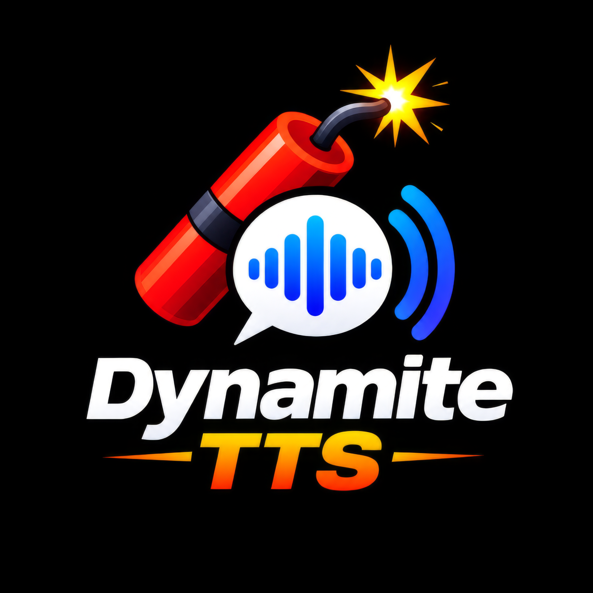

<p align="center">
  
</p>

# Dynamite TTS — Highlight-to-Speech for Windows, macOS, and Linux

A fast, lightweight, and 100% private highlight-to-speech utility. Highlight text in any app, press `Ctrl+Shift+S`, and hear it read aloud. Press `Ctrl+Shift+M` to cycle **Verbatim → Summary → Explain**.

One Rust codebase builds the tray (menu-bar) app for all three platforms:

- **Phonon** ([Gradium](https://github.com/gradium-ai/xn-ptts), Apache 2.0) speaks in-process on the CPU: no server, no GPU, first audio in tens of milliseconds, about 10x realtime.
- **Summary** and **Explain** send the highlight to a local [Lemonade Server](https://lemonade-server.ai) chat model, then speak the reply. The text never leaves the machine.

## Install

Prebuilt downloads are on the [Releases](https://github.com/robrab2000/dynamite-tts/releases) page. Every build bundles the Phonon English model, so Verbatim mode works offline from the first launch. Builds are unsigned, so SmartScreen and Gatekeeper may warn.

### Windows

Run **`DynamiteTts-Setup-v*.exe`**. It installs to `%LocalAppData%\Programs\DynamiteTTS`, can start the app at sign-in, and can install Lemonade through winget (needed only for Summary and Explain). The portable `win-x64` zip has the same files: keep `models\` next to `DynamiteTts.exe`.

Upgrading from 0.1.x keeps the install folder, the login item and your settings file. The Kokoro engine, with its 325 MB ONNX model and CUDA support, has been removed: Phonon is the only voice engine. The installer deletes the old Kokoro files.

### macOS (Apple Silicon, macOS 14+)

Unzip `DynamiteTTS-macos-arm64-v*.zip`, move **DynamiteTTS.app** to Applications, and open it. When asked, allow it under **System Settings → Privacy & Security → Accessibility**, which it needs to read the highlight. From a checkout, `packaging/macos/package-app.sh` builds the app and `packaging/macos/install.sh` installs it together with Lemonade and the chat model.

### Linux (GNOME on Wayland or X11, Ubuntu 22.04+)

```bash
tar -xzf DynamiteTts-linux-x64-v*.tar.gz
cd DynamiteTts-linux-x64-v*/
./install.sh            # --no-apt to skip system packages, --no-lemonade to skip Lemonade
```

The script installs the runtime packages with `apt` (GTK 3, AppIndicator, ALSA, wl-clipboard, xclip), puts the app under `~/.local/share/dynamite-tts/app` with a launcher at `~/.local/bin/dynamite-tts`, installs Lemonade with its chat model, and starts the tray icon. Run `packaging/linux/install.sh` from a checkout to build from source instead (it needs [Rust](https://rustup.rs)). `./uninstall.sh` removes the app, and `--purge` also removes Lemonade and the models.

How Linux differs:

- **No clipboard tricks.** A highlight *is* the PRIMARY selection, so the app reads it with `wl-paste` (Wayland) or `xclip`/`xsel` (X11). The clipboard is never touched and no keys are sent.
- **Shortcuts belong to the desktop.** Wayland does not let a background app grab keys. On GNOME the app registers two custom shortcuts (Settings → Keyboard → Custom Shortcuts) that run `dynamite-tts speak` and `dynamite-tts toggle-mode`. On X11 without GNOME the app grabs the keys itself. On KDE, Sway or Hyprland under Wayland, bind those two commands yourself.
- **Status is a notification.** A compositor will not float a window without focus, so phases are a desktop notification, updated in place. GNOME draws it top-centre.

## Using it

| | |
|---|---|
| `Ctrl+Shift+S` | Read the highlight. While speech is playing it stops instead; turn that off in Settings to have it read a new highlight. |
| `Ctrl+Shift+M` | Cycle Verbatim → Summary → Explain. |
| Tray menu | Mode, Settings… (brings an open Settings window to the front), Quit. Double-click the tray icon on Windows to open Settings. |
| Status pill | Top centre on Windows and macOS. It fades in and out, never takes focus, and shows moving bars: an orange ripple while it thinks and blue bars that follow the voice while it speaks. Click it to stop. Settings → General → Status display picks Off, Minimal (bars only, see-through), Standard (bars and a label) or Detailed (with the mode); **Preview** shows it. |
| Tray icon | Grey when ready, orange while thinking, blue while speaking; the fuse is lit only while it works. |

**Explain** opens by naming the selection and adapts to short terms versus longer passages. Settings controls its length (1–8 sentences) and audience (Technical or General). On macOS, when the highlight is short, the surrounding text of the focused field is sent with it so ambiguous words get the right sense.

**Settings** saves changes as you make them: voice, language, speed, output device, mode, chat model, Lemonade address, both shortcuts (click the button, then press the new shortcut), stop-sound, status display, and launch at login. **Test voice** speaks a sample through the running app.

The same binary is also a command-line client for the running app:

```bash
dynamite-tts              # start (or open Settings if already running)
dynamite-tts speak        # read the highlight (what the shortcut runs)
dynamite-tts toggle-mode  # Verbatim → Summary → Explain
dynamite-tts stop | settings | ping | quit
dynamite-tts --speak "Hello"
```

### Phonon

- About 100 catalogue voices in English, French, German, Spanish and Portuguese, plus the model's built-in voice. Each downloads on first use (about 250 KB).
- Speed maps onto Phonon's `duration_delta` condition, which covers about 0.67x–1.5x of its natural rate.
- **Tone** (Settings → Voice) is a three-band EQ for voices that sound dull or shrill: presets Flat, Warm, Clear, Bright and Soft, or Low (220 Hz shelf), Mid (1.8 kHz peak) and High (5 kHz shelf) sliders of ±12 dB. Three biquad filters run as the audio device plays, so a change is heard straight away, even mid-sentence. They add no latency and cost about 2.3 ns a sample (10 minutes of speech in 34 ms); Flat skips them.
- The bundled model is the English 31M checkpoint. For other languages, download a gated Phonon 40M checkpoint (CC BY-NC) from Hugging Face and set **Model folder** in Settings.
- Measured on a Ryzen AI 9 HX 370 (Windows, this build): load 35 ms, first audio 15–40 ms, 11 s of speech rendered in 1.7 s on 4 threads. Older measurements are in [docs/FINDINGS-tts-backends.md](docs/FINDINGS-tts-backends.md).
- x86-64 builds target x86-64-v3 (AVX2, roughly 2013 or newer CPUs), the same baseline as Gradium's own binaries. On Apple Silicon, `ptts` uses the Accelerate framework.

## Files

| | Windows | macOS | Linux |
|---|---|---|---|
| Settings | `%AppData%\DynamiteTts\settings.json` | `~/Library/Application Support/DynamiteTTS/settings.json` | `~/.config/dynamite-tts/settings.json` |
| Models, Lemonade | `%LocalAppData%\DynamiteTts` | `~/Library/Application Support/DynamiteTTS` | `~/.local/share/dynamite-tts` |
| Log | `%LocalAppData%\DynamiteTts\logs\dynamite.log` | `~/Library/Logs/DynamiteTTS/dynamite.log` | `~/.local/state/dynamite-tts/dynamite.log` |

The log records timings and phases only, never the spoken text. Settings files written by the earlier C# (Windows) and Python (Linux) apps still load.

## Building from source

Needs [Rust](https://rustup.rs) 1.89 or later. On Linux you also need `pkg-config libgtk-3-dev libasound2-dev` (AppIndicator is loaded at runtime, so only its library is needed).

```bash
cargo run --release          # run the tray app
cargo test                   # unit tests (no audio hardware or display needed)
```

Release packages:

```bash
./packaging/windows/build.ps1        # target/windows: zip, plus Setup.exe when Inno Setup 6 is installed
./packaging/macos/package-app.sh --zip
./packaging/linux/package.sh
```

The `Release` workflow builds and publishes all three when a `v*` tag is pushed. `CI` runs clippy and the tests on Windows, macOS and Linux for every pull request.

## Layout

```
src/
├── main.rs          # command line: start the app, or send a command to the running one
├── app.rs           # event loop (tao): tray, shortcuts, status, control commands
├── speech.rs        # pipeline: sanitize → Summary/Explain → Phonon → player; generations cancel stale work
├── phonon.rs        # in-process Phonon (ptts): pinned, hash-checked model download, voices, speed, streaming
├── voices.rs        # Phonon voice catalogue (assets/phonon-voices.jsonl)
├── lemonade.rs      # Lemonade HTTP client: health, starting lemond, backends, load/pull, chat, streamed PCM
├── audio.rs         # cpal playback: resampling, sessions, back-pressure, stop chime, devices
├── selection/       # reading the highlight: Ctrl+C on Windows, Accessibility/Cmd+C on macOS, PRIMARY on Linux
├── status.rs        # status pill (Windows, macOS) or notifications (Linux)
├── tray.rs          # tray icon and menu
├── settings.rs      # settings model and lenient JSON store
├── settings_ui.rs   # Settings window (eframe), run as `dynamite-tts --settings-window`
├── hotkey.rs        # shortcut parsing: storage form, global-hotkey, GTK accelerators
├── gnome.rs         # GNOME custom keybindings
├── control.rs       # single-instance lock and local control socket / named pipe
├── autostart.rs     # launch at login: Run key, LaunchAgent, XDG autostart
├── text.rs          # Markdown/URL cleanup, chunking, Summary/Explain prompts
└── applog.rs, paths.rs
packaging/           # Windows installer, macOS .app, Linux tarball and install scripts
assets/              # logo, icons (regenerate with `cargo run --example make_icons`), voice catalogue
```
