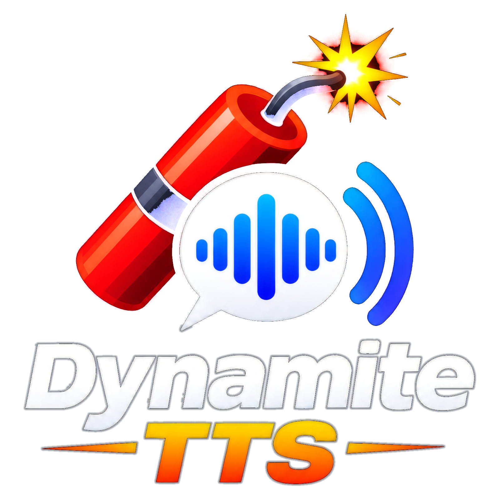
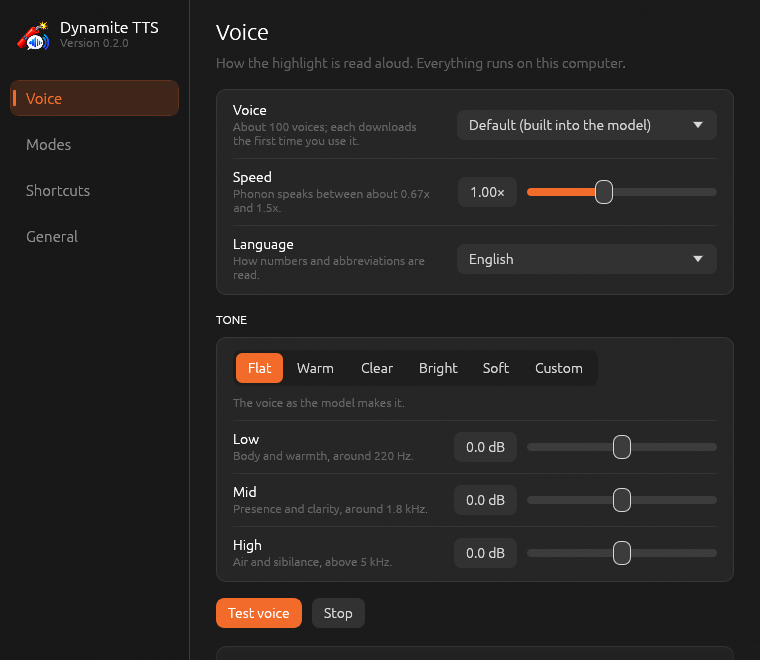

<p align="center">
  
</p>

<p align="center">
  <b>Highlight text anywhere. Press a shortcut. Hear it read aloud — instantly, privately, on your own computer.</b><br>
  Windows · macOS · Linux
</p>

---

Dynamite TTS lives in your tray (menu bar). Highlight text in any app — a browser, a PDF, your editor — and press **`Ctrl+Shift+S`**. Speech starts in tens of milliseconds, because the voice model runs right inside the app on your CPU: no cloud, no account, no GPU, nothing leaves the machine.

Press **`Ctrl+Shift+M`** to switch modes:

- **Verbatim** reads the highlight as it is.
- **Summary** reads a short summary of it.
- **Explain** explains what the highlight means. On macOS it also sends the text around a short highlight, so "Electron" next to "desktop apps" isn't explained as a particle.
- **ELI5** explains the highlight as if to a five-year-old: short sentences, everyday words, and one comparison from daily life. On macOS it reads the paragraphs around the highlight first, so it explains what the words mean in that passage.

Summary, Explain and ELI5 use a small chat model running locally in [Lemonade Server](https://lemonade-server.ai). Verbatim needs nothing but the app.

## Features

- **Fast, local speech.** [Phonon](https://github.com/gradium-ai/xn-ptts) by Gradium (Apache 2.0) runs in-process: the model loads in under 0.1 s, the first audio arrives 15–40 ms after the request, and a paragraph renders about 10× faster than it is spoken. The English model ships with every download.
- **About 100 voices** in English, French, German, Spanish and Portuguese, each downloaded the first time you pick it (about 250 KB). Speed from 0.67× to 1.5×.
- **Tone control.** A three-band EQ with presets (Flat, Warm, Clear, Bright, Soft) or your own Low / Mid / High settings, for voices that sound dull or shrill. Changes are heard straight away, even mid-sentence, and add no latency.
- **A status pill you can tune.** A small pill at the top of the screen fades in while the app works: an orange ripple while it thinks, blue bars that follow the voice while it speaks. Click it to stop. Choose Off, Minimal, Standard or Detailed.
- **A tray icon that shows what's happening.** Grey when ready, orange while thinking, blue while speaking, with the fuse lit only while it's busy.
- **Respectful of your clipboard.** On Windows and macOS anything the app copies to read the highlight is put back; on Linux the clipboard is never touched.
- **Private by design.** Text is never sent anywhere, and the log records timings only, never what was read.

## Install

Download the file for your system from the [latest release](https://github.com/robrab2000/dynamite-tts/releases/latest). Builds are not code-signed yet, so Windows SmartScreen and macOS Gatekeeper may ask you to confirm the first launch.

### Windows 10 (1809+) or 11, 64-bit

1. Run **`DynamiteTts-Setup-v….exe`**. If SmartScreen appears, choose **More info → Run anyway**.
2. Leave **Install Lemonade Server** ticked if you want Summary and Explain (it uses winget), and **Start Dynamite TTS when I sign in** if you like.
3. The app starts in the tray. Highlight some text and press `Ctrl+Shift+S`.

It installs to `%LocalAppData%\Programs\DynamiteTTS` and needs no administrator rights. The **`win-x64` zip** is a portable copy of the same files; keep the `models` folder next to `DynamiteTts.exe`.

### macOS 14+ on Apple Silicon

1. Download **`Install-Dynamite-TTS-macOS-v….zip`** and open it. Safari unzips it for you.
2. Double-click **Install-Dynamite-TTS.command** in the folder. Terminal opens, downloads the app, and shows each step; the window stays open until you press Return. The **README.txt** next to it has these steps too.
3. If macOS refuses to open it because the download isn't notarized, go to **System Settings → Privacy & Security**, click **Open Anyway**, and double-click it again. Or open Terminal, type `bash ` with a space, drag the installer into the window, and press Return.
4. Answer **Y** to install Lemonade Server and its chat model if you want Summary and Explain, or **n** for Verbatim only.
5. When the app opens, allow it under **System Settings → Privacy & Security → Accessibility**. It needs this to read the highlighted text.

The installer copies the app to `~/Applications`, so it needs no administrator password. **`DynamiteTTS-macos-arm64-v….zip`** has the app itself with the same installer and README, for an offline install or to do it by hand: drag **DynamiteTTS.app** to Applications, open it with right-click → **Open**, and run `install-lemonade.sh` for Summary and Explain.

### Linux (Ubuntu 22.04+ and similar; GNOME on Wayland or X11)

```bash
tar -xzf DynamiteTts-linux-x64-v*.tar.gz
cd DynamiteTts-linux-x64-v*/
./install.sh
```

The script installs a few system packages with `apt` (GTK 3, AppIndicator, ALSA, wl-clipboard, xclip; it asks for your password once), puts the app in `~/.local/share/dynamite-tts` with a `dynamite-tts` command in `~/.local/bin`, installs Lemonade and its chat model, and starts the tray icon. Options: `--no-apt` if you install the packages yourself, `--no-lemonade` to skip Lemonade.

Linux works a little differently, because of how Wayland is designed:

- **The highlight is read directly.** On Linux a highlight *is* the "primary selection", so the app reads it with `wl-paste` or `xclip`; no keys are pressed and the clipboard is never used.
- **Shortcuts are set up in the desktop.** A Wayland app can't grab keys, so on GNOME the app adds two custom shortcuts (Settings → Keyboard → Custom Shortcuts) that run `dynamite-tts speak` and `dynamite-tts toggle-mode`. On X11 without GNOME it grabs the keys itself. On KDE, Sway or Hyprland under Wayland, bind those two commands yourself.
- **The status is a notification**, updated in place, instead of the pill.

Hardware: x86-64 builds need a CPU with AVX2 (Intel Haswell / AMD Excavator, about 2013, or newer), the same baseline as Gradium's own Phonon builds. Apple Silicon is always fine.

## Using it

| | |
|---|---|
| **`Ctrl+Shift+S`** | Read the highlight. Pressed again while speaking, it stops (or, if you turn that off in Settings, reads the new highlight). |
| **`Ctrl+Shift+M`** | Switch mode: Verbatim → Summary → Explain → ELI5. |
| **Status pill** | Click it to stop speaking. |
| **Tray menu** | Mode, Settings…, Quit. On Windows, double-click the tray icon for Settings. |

Both shortcuts can be changed in Settings: click the shortcut, then press the new keys.

### Settings

Changes are saved as you make them and apply at once.

<p align="center">
  
</p>

- **Voice:** voice, speed, language, tone (EQ), output device, and the Phonon model folder (leave it on the built-in English model unless you have a Phonon 40M checkpoint for another language). **Test voice** plays a sample.
- **Modes:** the speak mode, how long explanations are (1–8 sentences) and who they're for (Technical or General), and the Lemonade chat model and address.
- **Shortcuts:** the two shortcuts, and whether the speak shortcut stops speech that is playing.
- **General:** the status display (with **Preview**), start at login, the stop sound, and the log folder.

### Tone presets

| Preset | Low (220 Hz) | Mid (1.8 kHz) | High (5 kHz) | For |
|---|---|---|---|---|
| Flat | 0 | 0 | 0 | the voice as the model makes it |
| Warm | +3 | 0 | −3 | thin or shrill voices |
| Clear | −2 | +2.5 | +3 | dull or muffled voices |
| Bright | 0 | +1 | +5 | extra sparkle |
| Soft | +1 | −1.5 | −5 | harsh S and T sounds |

Moving a slider (±12 dB) switches to Custom. The EQ is three biquad filters applied as the sound card plays: no added delay, about 2–6 ns per sample (ten minutes of speech in well under a tenth of a second), and nothing at all on Flat.

### Status display

| Style | Shows |
|---|---|
| Off | Nothing on screen; only the tray icon changes. |
| Minimal | A small see-through pill with just the moving bars. Mode changes and errors still show briefly. |
| Standard | Bars and a short label such as "Speaking" or "Summarizing…". |
| Detailed | A larger pill with the current mode and how to stop. |

### Command line

The same program is a remote control for the running app (this is what the Linux shortcuts use):

```bash
dynamite-tts                 # start the app, or open Settings if it's running
dynamite-tts speak           # read the highlight
dynamite-tts toggle-mode     # Verbatim → Summary → Explain → ELI5
dynamite-tts stop | settings | ping | quit
dynamite-tts --speak "Hello" # read some text
```

## Files and privacy

| | Windows | macOS | Linux |
|---|---|---|---|
| Settings | `%AppData%\DynamiteTts\settings.json` | `~/Library/Application Support/DynamiteTTS/settings.json` | `~/.config/dynamite-tts/settings.json` |
| Models, voices, Lemonade | `%LocalAppData%\DynamiteTts` | `~/Library/Application Support/DynamiteTTS` | `~/.local/share/dynamite-tts` |
| Log | `%LocalAppData%\DynamiteTts\logs\dynamite.log` | `~/Library/Logs/DynamiteTTS/dynamite.log` | `~/.local/state/dynamite-tts/dynamite.log` |

Nothing you highlight is sent over the network or written to disk. The only downloads are the Phonon model (if it didn't come with the app), voices you choose, and, if you use them, Lemonade's chat model. Downloads come from Hugging Face, pinned to fixed versions, and the model files are checked against SHA-256 hashes.

## Troubleshooting

- **Nothing happens when I press the shortcut.** Another app may own the same keys; Dynamite says so when it starts. Pick another shortcut in Settings → Shortcuts. On Linux outside GNOME, bind `dynamite-tts speak` in your desktop's keyboard settings.
- **"No text selected" on macOS.** Allow Dynamite TTS under System Settings → Privacy & Security → Accessibility, then quit and reopen it.
- **"No text selected" on Linux.** Install `wl-clipboard` (Wayland) or `xclip` (X11).
- **Summary, Explain or ELI5 says Lemonade isn't running.** Install Lemonade (Windows: `winget install AMD.LemonadeServer`; macOS and Linux: the `install-lemonade.sh` scripts). Dynamite starts it when needed.
- **Something else.** The log (see above) records what the app did, without the text it read. Settings → General → Open folder takes you there.

## Building from source

Want to help? See [CONTRIBUTING.md](CONTRIBUTING.md) for setup on each system, the checks CI runs, and the project's rules.

You need [Rust](https://rustup.rs) 1.89 or newer. On Linux, also `pkg-config libgtk-3-dev libasound2-dev`.

```bash
cargo run --release     # build and run the app
cargo test              # unit tests; no sound card or display needed
```

Release packages:

```bash
./packaging/windows/build.ps1           # target/windows: zip, plus the installer if Inno Setup 6 is installed
./packaging/macos/package-app.sh --zip  # target/macos: DynamiteTTS.app, its zip, and the installer zip
./packaging/linux/package.sh            # target/linux: the tarball
```

To make a release, set the version in `Cargo.toml` and push a `v` tag (for example `v0.2.0`): the **Release** workflow tests and builds all three packages and publishes them. **CI** runs clippy and the tests on Windows, macOS and Linux for every pull request.

Some checks render images instead of needing a screen: `cargo test -- --ignored` writes the Settings pages, the status pills and an EQ benchmark to `target/`, and `cargo run --example make_icons` regenerates every icon from `assets/logo.png` (with previews in `target/icon-preview`).

<details>
<summary>Source layout</summary>

```
src/
├── main.rs          command line: start the app, or send a command to the running one
├── app.rs           event loop (tao): tray, shortcuts, status pill, control commands
├── speech.rs        sanitize → Summary/Explain/ELI5 → Phonon → player; newer requests cancel older ones
├── phonon.rs        in-process Phonon (ptts): pinned, hash-checked model download, voices, speed
├── voices.rs        the Phonon voice catalogue (assets/phonon-voices.jsonl)
├── audio.rs         playback (cpal): resampling, back-pressure, live level, stop chime, devices
├── eq.rs            the three-band tone control
├── lemonade.rs      Lemonade client: health, starting the server, model load/pull, chat
├── selection/       reading the highlight: Ctrl+C on Windows, Accessibility/Cmd+C on macOS, primary selection on Linux
├── status.rs        the status pill (Windows, macOS) and notifications (Linux)
├── tray.rs          tray icon and menu
├── settings.rs      settings and their JSON file (reads the 0.1.x formats too)
├── settings_ui.rs   the Settings window (eframe), run as `dynamite-tts --settings-window`
├── hotkey.rs        shortcut parsing: storage form, global-hotkey, GTK accelerators
├── gnome.rs         GNOME custom shortcuts
├── control.rs       single-instance lock and the local control socket / named pipe
├── autostart.rs     start at login: Run key, LaunchAgent, XDG autostart
├── text.rs          Markdown and URL cleanup, chunking, Summary/Explain/ELI5 prompts
└── applog.rs, paths.rs
examples/make_icons.rs   regenerates the icons from the logo
packaging/               Windows installer, macOS app bundle, Linux tarball and scripts
assets/                  logo, icons, voice catalogue
docs/                    images and engine measurements
```
</details>

## Credits and license

Dynamite TTS is MIT-licensed (see [LICENSE](LICENSE)). It speaks with [Phonon](https://github.com/gradium-ai/xn-ptts) by Gradium (the runtime and the bundled 31M English model are Apache 2.0; the 40M multilingual checkpoints are CC BY-NC and not bundled), and uses [Lemonade Server](https://lemonade-server.ai) by AMD for Summary and Explain.
